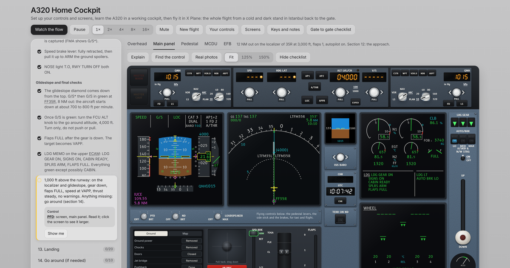

# A320 Home Cockpit

A free A320 home cockpit for flight sim fans, made for fun: set up your joystick, throttle and rudder pedals as X Plane wants them, spread a working Airbus A320 cockpit over your screens, and learn the whole flight, from a cold and dark stand at Istanbul Airport through the MCDU setup, the takeoff, the ILS and the landing, back to the gate. Then fly the same flight in X Plane with the gate to gate checklist.

**Open it: https://onatcakici.github.io/a320trainer/**

## What it does

* Your controls: each axis and button of your side stick or joystick, throttle and rudder pedals given the job of an A320 control, with a bar that shows its whole travel as you move it. Every job names its X Plane axis or command, so the sim gets the same setup, and the detents of your thrust levers are set to IDLE, CL, FLX MCT and TOGA.
* Screens: the PFD and ND, the upper and lower ECAM, the overhead panel, the main panel, the pedestal, the MCDU or the EFB, each on a screen of its own and kept in step. In Chrome and Edge each window goes to its screen for you.
* A cockpit where every switch, knob, lever and screen of the flow works: the overhead panel, the glareshield and main panel, the pedestal and the MCDU, with the systems behind them and the sounds of the aircraft.
* A guide beside the cockpit that names each control, says why it matters, and can fly the whole flow for you while you watch.
* New flight, which sets up each session as an instructor would: where to start, from cold and dark at the gate to 12 NM out on the ILS; the weather, from a clear day to fog with a CAT 3 autoland; a light, typical or heavy load; day or night; and how much help you get, up to a check ride with none.
* An EFB with the papers of the flight, the flight plan, the weather and the load sheet, and the takeoff performance worked out from them.
* The MCDU taught key by key, and an MCDU practice for other flights around Istanbul and South Florida.
* A gate to gate checklist to fly the same flight in X Plane, every MCDU entry and every number the same.

## With X Plane

1. Plug in your controls, open Your controls and give each one its job. Move each through its whole travel, and set the detents of your thrust levers.
2. In X Plane, under Settings, Joystick, give each axis and button the job the home cockpit names for it. An A320 add on, such as the ToLiss A320, may have commands of its own for the side stick and thrust lever buttons, and its own page for the detents: use those.
3. Fly the Istanbul flight in the home cockpit, with Watch the flow first and then on your own, on as many screens as you like.
4. Fly it again in X Plane, with the gate to gate checklist on a screen beside it.

## On an iPad, a phone or a computer

It runs in any current browser. On an iPad, open the address in Safari, then Share, Add to Home Screen: it opens full screen with its own icon, and after the first visit it also works without internet. On a computer, Chrome and Edge can install it as an app from the address bar. Your controls needs a browser that reads game controllers, such as Chrome, Edge or Firefox.

## Just for fun

This project is a free game for flight sim fans, made for fun: for setting up a home cockpit and learning how the A320 works. It is not official training: not an approved training device, course, checklist or source of flight data, and it must never be used for real flight operations, flight planning or navigation, or towards a licence or rating.

Its procedures, speeds, weights, charts and navigation data are simplified, partly made up for the Istanbul flight, and out of date. Real flights follow the operator's approved manuals and checklists.

It is provided as is, without warranty of any kind, as the MIT licence says, and the author accepts no responsibility or liability for any use of it.

Airbus, A320 and A330 are trademarks of Airbus. X Plane is a trademark of Laminar Research. This project is independent and not affiliated with, endorsed or sponsored by Airbus or Laminar Research. Other product names belong to their owners.

## Privacy

The home cockpit sets no cookies and collects nothing. Your settings, your controls, your progress and your ticks stay in your own browser, and after the first visit it works offline.

## Credits

* Code under the MIT licence, see `LICENSE`.
* B612 and B612 Mono, the typefaces made for Airbus cockpit displays, by the B612 Project Authors under the SIL Open Font License 1.1, see `fonts/OFL.txt`.
* Inter, by the Inter Project Authors under the SIL Open Font License 1.1, see `fonts/OFL_Inter.txt`.
* The photos come from Wikimedia Commons and keep their own licences (CC BY, CC BY SA, CC0 or public domain); the author, the licence and a link to the original are with each photo in the checklist. They are not covered by the MIT licence.
* Florida data from the FAA Coded Instrument Flight Procedures, Istanbul data from the AIP Türkiye published by DHMI, both simplified and out of date.
